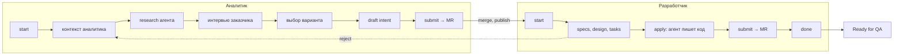

# ai-first

AI-first процесс разработки платформы Managed Kubernetes: правила для агентов, скилы ролей, LLM Wiki.

Репозиторий отвечает на три вопроса:

1. Как агент работает в проекте — `AGENTS.md`, собранный из `rules/`.
2. Как задача идёт от CR до QA — скрипты ролей аналитика и разработчика с проверками (гейтами).
3. Где агент берёт контекст — LLM Wiki в `wiki/`, которую пишет только CI.

## Процесс



| Статус Jira | Кто | Команда |
|-------------|-----|---------|
| Open → Analysis | аналитик | `analyst.py start` |
| Analysis | аналитик и агент | `research`, `interview`, `draft`, `check` |
| Analysis → Intent Review | аналитик | `analyst.py submit` |
| Intent Review → Ready for Dev | аналитик после merge | `analyst.py publish` |
| Ready for Dev → In Progress | разработчик | `developer.py start` |
| In Progress | разработчик и агент | `check`, `apply` |
| In Progress → Code Review | разработчик | `developer.py submit` |
| Code Review → Ready for QA | разработчик после merge | `developer.py done` |
| возврат intent: → Analysis | разработчик | `developer.py reject` |

Каждая команда сначала выполняет все проверки. Если проверка не пройдена, скрипт выводит «СТОП» и ничего не меняет в Jira, GitLab и git.
Всем обработанным задачам скрипты ставят метки `SDD` и `TA`.

## Репозитории

```
ai-first (этот репозиторий)          master-spec                                  компоненты
  AGENTS.md, rules/, skills/           openspec/changes/intents/<id>/               код, MR, теги
  scripts/                               discovery.md, intent.md     ← аналитик    ↓ тег
  wiki/                                openspec/changes/<id>/                       CI ai-first
    code/<компонент>/  ← CI по тегу      specs/, design.md, tasks.md ← разработчик  ↓
    code/releases/     ← CI по релизу  openspec/specs/  ← openspec archive (QA)    wiki/code/<компонент>/
    changes/<KEY>.md   ← CI по merge
    l2/, l3/           ← Confluence
```

- **master-spec** — единственное место спецификаций (OpenSpec, схема `mk8s`). Шаблон: `templates/master-spec/`.
- **Репозиторий чартов** — состав платформы. Его тег — версия платформы.
- **Jira** — статусы и метки. Комментарии со ссылками на MR пишут скрипты.

## Быстрый старт

1. Клонируй ai-first и master-spec рядом:

   ```bash
   git clone https://gitlab.example.com/mk8s/ai-first.git
   git clone https://gitlab.example.com/mk8s/master-spec.git
   cd ai-first
   pip install -r requirements.txt
   npm install -g @fission-ai/openspec@1.14.3
   ```

2. Задай роль. Скрипт создаёт `config.json` с правами 600:

   ```bash
   python scripts/tracker.py setup --role analyst    # analyst | developer | qa
   ```

3. Заполни в `config.json` токены Jira и GitLab, при необходимости — `openai.api_key` (LLM-шлюз) и пути `repos`.
4. Проверь доступ:

   ```bash
   python scripts/tracker.py whoami
   ```

5. Работай через агента. Агент читает `AGENTS.md` (Claude Code — через `CLAUDE.md`) и использует скилы своей роли.

## Конфигурация

| Файл | В git | Содержание |
|------|-------|-----------|
| `config.example.json` | да | командные значения: URL Jira и GitLab, статусы, JQL, метки, `intents_dir`, ревьюеры intent, гейты, адрес LLM-шлюза и `docs_llm` |
| `config.json` | нет | личное: роль, токены, OpenAI API, пути к клонам. Перекрывает поля образца |
| `wiki/code/components.toml` | да | реестр компонентов и модулей: репозиторий, чарт, владелец, ревьюеры |

Переменные `JIRA_TOKEN`, `JIRA_EMAIL`, `GITLAB_TOKEN`, `OPENAI_API_KEY` имеют приоритет над `config.json`. Их использует CI.
Если `config.json` попал в git, скрипты останавливаются: отзови токены и выпусти новые.

## Скилы

| Скил | Скрипт | Кто использует |
|------|--------|----------------|
| `tracker` | `tracker.py` | все: роль, доступ, чтение Jira и GitLab |
| `analyst` | `analyst.py` | аналитик |
| `developer` | `developer.py` | разработчик |
| `spec-guard` | `spec_guard.py` | CI master-spec: роль ветки меняет только свои файлы |
| `wiki-context` | `wiki_context.py` | агент перед каждой задачей |
| `code-docs` | `code_docs.py` | CI: документация компонента по тегу |
| `release-docs` | `release_docs.py` | CI: страница релиза платформы |
| `changes-sync` | `changes_sync.py` | CI: страницы изменений для QA |
| `wiki-index`, `wiki-lint`, `wiki-log` | `wiki_*.py` | CI и проверки MR |
| `build-agents-md` | `build_agents_md.py` | сборка `AGENTS.md` из `rules/` |
| `new-skill`, `check-skills` | `new_skill.py`, `check_skills.py` | новый скил и проверка пар скил — скрипт |

Каждый скил — `skills/<имя>/SKILL.md` и скрипт `scripts/<имя>.py`. Общие модули — `scripts/_*.py`.

## LLM Wiki

В wiki пишет только CI ai-first. Job записи идут по одному (`resource_group: wiki-writer`).

| Событие | Шаблон триггера | Результат |
|---------|-----------------|-----------|
| тег компонента | `templates/component-ci/wiki-docs.gitlab-ci.yml` | `wiki/code/<компонент>/`: README, API, конфигурация, метрики, CHANGELOG |
| тег репозитория чартов | `templates/charts-ci/wiki-release.gitlab-ci.yml` | страница релиза со ссылками на документацию версий |
| merge спецификации | `templates/master-spec/.gitlab-ci.yml` | `wiki/changes/<KEY>.md` для QA |
| расписание | расписание CI ai-first | сверка страниц изменений по Jira |

Документация кода строится в два слоя:

- **факты** — tree-sitter для Go, `.proto`, CRD, `values.yaml`, merge-коммиты. Сигнатуры, API, метрики, конфигурация и CHANGELOG пишет только парсер;
- **текст** — LLM через OpenAI-совместимый API (Qwen, DeepSeek на внутреннем шлюзе): обзор компонента и описания без комментария в коде.

Каждое имя в тексте LLM скрипт сверяет с фактами парсера. Предложение с выдуманным именем удаляется, а текст помечается «(LLM)».
Секреты вычищаются до отправки. Ответы кэшируются, поэтому неизменённый код не вызывает модель повторно.
Без ключа или с `--no-llm` генератор пишет только факты.

## Правила

`AGENTS.md` собирается из `rules/`. Не правь его вручную:

```bash
python scripts/build_agents_md.py
```

| Файл | Раздел |
|------|--------|
| `rules/karpathy.md` | поведение агента при написании кода |
| `rules/flow.md` | роли, гейты, конфигурация, работа команды |
| `rules/wiki.md` | LLM Wiki: разделы, версии, требования к репозиторию компонента |
| `rules/pii.md` | персональные данные и безопасность, 152-ФЗ |
| `rules/writing.md` | упрощённый технический русский язык |

## Требования к GitLab

- Метод слияния в проектах компонентов — merge commit.
- Шаблон merge-коммита включает `%{description}`: строка «Влияние на L2/L3» попадает в CHANGELOG.
- CI master-spec запускает `spec_guard.py` для каждого MR.
- Токены бота CI: `JIRA_TOKEN`, `GITLAB_TOKEN`, `PUSH_TOKEN` (см. `.gitlab-ci.yml`).

## Пример результата

`examples/wiki-sample/` — wiki, созданная генераторами на тестовых репозиториях: компонент с gRPC, CRD и метриками, общий модуль, три релиза.
