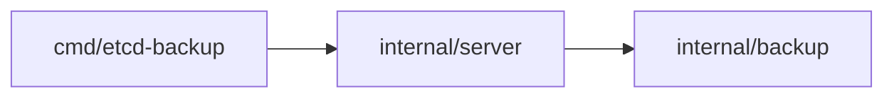

# etcd-backup — обзор

## Паспорт

| Поле | Значение |
|------|----------|
| Тип | компонент |
| Репозиторий | https://gitlab.example.com/mk8s/etcd-backup |
| Версия | `v1.5.0` · коммит `3f21e81d1571` |
| Go | `gitlab.example.com/mk8s/etcd-backup` · go 1.22 |
| Точки входа | `cmd/etcd-backup` |
| Тесты | тестовых функций: 2; пакетов без тестов: 1 из 3 |
| Модули платформы | `gitlab.example.com/mk8s/core@v1.2.0` |

## Архитектура

Сервис принимает запросы по gRPC и пишет копии etcd в S3.

## Документы команды

- [ADR 0001. Хранилище копий](docs/adr/0001-storage.md)

## Пакеты

| Пакет | Описание | Тесты |
|-------|----------|-------|
| `cmd/etcd-backup` | — | — |
| `internal/backup` | Создаёт резервные копии etcd в объектном хранилище | 2 |
| `internal/server` | Запускает gRPC-сервер EtcdBackup | — |

### Связи пакетов

## Разделы

- [API](api.md)
- [Метрики](metrics.md)
- [Изменения](CHANGELOG.md)
